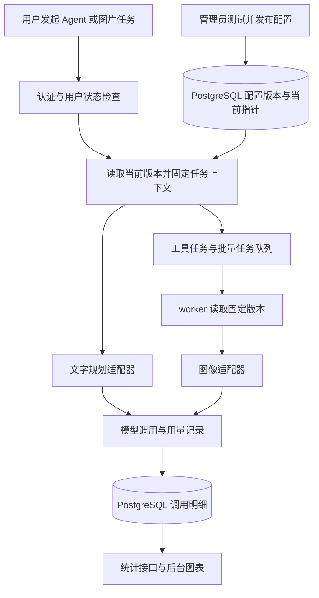

# 后台管理、模型热更新与用量统计实施计划

日期：2026-10-15  
状态：规划草案，尚未实施  
已确认：管理员统一配置模型，对所有用户生效；文字模型和图像模型分别配置。

## 1. 目标与交付范围

新增独立入口 `/admin`，供管理员管理模型厂商、发布运行配置、管理用户、查询模型用量。复用现有前后端和数据库，以独立后台布局与权限隔离业务页面。

本期交付：

- 厂商与模型配置：选择厂商、连接配置和模型，测试后发布，支持历史版本回滚。
- 模型热更新：不重启 API 或 worker；发布后接收的新任务使用新版本。
- 用户管理：查询、创建、启停、调整角色、重置密码、查看个人用量。
- 用量查询：按全部、用户、模型，以及用户与模型的组合查询。
- 统计图表：用量趋势、模型分布、用户排行、图片产量、质量与耗时。
- 操作审计：记录配置发布、回滚、用户状态和权限变更。

首期不包含充值扣费、套餐配额、自动模型降级、用户自选模型、任意厂商协议的自动适配。后续如需费用统计，再增加价格版本与币种规则；Token 数量本身不直接等于费用。

## 2. 项目现状与方案选择

### 2.1 已核实的现状

| 部分 | 目前实现 | 本次需要补充 |
| --- | --- | --- |
| 后端 | FastAPI、SQLAlchemy、PostgreSQL，Alembic 迁移 | 后台接口、权限依赖和配置/用量数据表 |
| 前端 | React、React Router、TanStack Query | 后台布局、路由、表单、统计图表 |
| 文字模型 | `agent/llm.py` 中使用 ChatOpenAI，经百炼兼容接口调用，`planner()` 被缓存 | 按配置版本创建客户端、校验工具调用能力、采集 usage |
| 图像模型 | `providers/` 有 mock 与 DashScope；接口主要返回图片字节 | 多协议适配、能力声明、返回图片及用量元数据 |
| 配置 | `config.py` 从环境变量读取，Settings 和 provider 使用进程缓存 | 数据库存储业务配置，解除对全局单例的依赖 |
| 用户 | 用户名、密码哈希，JWT Cookie 登录；请求时会查询用户 | 管理员角色、禁用状态、会话撤销 |
| 任务 | AgentRun、ToolRun；API 与 arq worker 分进程执行 | 固定模型配置版本、传递用量上下文 |
| 用量 | 没有独立调用用量表；Agent 目前只取正文与工具调用 | 在模型调用边界统一记录，覆盖失败和重试 |

### 2.2 方案比较

| 方案 | 收益 | 成本与限制 |
| --- | --- | --- |
| A：现有应用增加 `/admin`，配置存数据库（推荐） | 复用登录、部署与数据，适合当前规模；能保证 API 和 worker 一致读取配置 | 需要改造模型调用边界并补充管理员权限 |
| B：单独部署后台前端，共用当前后端 | 后台可单独发布，适合以后由独立团队维护 | 增加部署和跨域配置，当前收益有限 |
| C：另建配置中心与统计服务 | 适合多个业务系统共用模型网关 | 服务和一致性维护成本较高，首期不采用 |

采用 A。业务配置以 PostgreSQL 为准，Redis 仅用于通知与现有任务队列；统计首期直接查询 PostgreSQL，不新增分析数据库。

## 3. 后台页面与操作流程

### 3.1 导航结构

| 页面 | 路由 | 主要内容 |
| --- | --- | --- |
| 数据概览 | `/admin` | 核心指标、最近 7 天趋势、当前生效模型、异常摘要 |
| 模型配置 | `/admin/models` | 厂商连接、模型目录、运行配置草稿、测试与发布、历史回滚 |
| 用户管理 | `/admin/users` | 搜索、状态和角色筛选、用户操作 |
| 用户详情 | `/admin/users/:id` | 基本信息、个人用量、模型分布、调用明细 |
| 用量统计 | `/admin/usage` | 全局筛选、图表、汇总表、调用明细与 CSV 导出 |
| 操作日志 | `/admin/audit` | 操作者、时间、对象、动作、脱敏变更摘要 |

后台沿用现有配色和组件风格；采用左侧导航、顶部标题与操作、主体卡片/表格。窄屏时收起导航，表格允许横向滚动。普通用户不显示后台入口，后端仍独立校验权限。

### 3.2 模型配置流程

1. 新建厂商连接：选择适配协议、填写名称、接口地址与 API Key，保存后只展示密钥尾号。
2. 配置模型：从已维护的目录选择，或手动填写厂商模型 ID，并声明支持的能力和参数范围。
3. 分别选择三项默认绑定：Agent 文字模型、文生图模型、图像编辑模型。后两项可以来自不同连接或不同厂商。
4. 测试连接和能力：文字模型必须能返回当前 Agent 需要的结构化工具调用；图片测试按生图/编辑分别执行。
5. 查看发布摘要：本次修改、影响能力、旧/新版本。测试会真实调用模型，按钮旁说明会产生用量。
6. 发布后显示版本号、生效时间和操作者。回滚从历史版本生成一个新的发布版本，保留完整历史。

不同模型仅展示它实际支持的参数，例如 temperature、输出长度、尺寸、图片数量、参考图、负向提示词。不能将一个通用 JSON 参数框作为主要配置方式。

模型目录接口若厂商支持则可辅助拉取；手动维护始终可用。接口能列出模型不代表支持当前工作流，发布仍需通过能力测试。修改影响连接或模型行为的配置后，原测试结果失效。

### 3.3 首期厂商接入边界

- 保留现有 DashScope 图像能力及文字兼容调用。
- 增加可配置的 OpenAI 兼容文字适配器，支持独立 base URL、密钥、模型 ID。
- 增加 OpenAI 图像协议适配器，生图与图片编辑分别验证；不假定所有标称兼容的平台都实现相同图像接口。
- mock 仅用于开发与测试，默认不计入真实用量总览。
- 每个上线厂商使用其正式文档和测试账号完成验收。至少用两个真实连接验证文字切换和图像切换；只有配置表单不算完成多厂商接入。
- 其他原生协议通过新增适配器接入。管理员可以热切换已支持的厂商和模型；接入一种全新协议仍需开发部署。

## 4. 热更新与任务一致性

### 4.1 配置层次

- **厂商连接**：厂商名称、适配器类型、完整接口地址、加密凭证版本、启用状态。
- **模型定义**：连接引用、厂商模型 ID、能力集合、允许参数与默认值。
- **配置发布版本**：冻结三项模型绑定、参数和连接/凭证版本，发布后不可直接修改。
- **当前版本指针**：指向唯一生效版本，使用数据库事务原子更新。

`.env` 继续保存数据库、Redis、JWT 和配置加密主密钥等基础设施信息。现有模型配置可经受控的一次性导入形成初始发布版本；导入不在日志中输出密钥。正式启用后，模型配置读取失败应明确报错，不静默退回旧环境变量。

### 4.2 生效规则

1. 新 Agent 轮次或独立工具/批量请求进入时，从数据库读取当前版本，并保存版本引用。
2. 一轮 Agent 的文字规划、后续图像步骤、等待确认后继续执行的步骤使用同一个发布版本。
3. 独立工具在入队前固定版本；同一批处理的所有子任务继承相同版本。已经排队的任务不因发布而换模型。
4. 失败重试沿用原版本，便于复现；需要使用新配置时重新发起任务。
5. API、worker 都按记录中的版本构建客户端，不能在真正执行时重新读取“当前模型”替代任务绑定。
6. 发布提交后新接收的任务读取新版本；与发布并发的请求以数据库读取到的版本为准，并可从记录中追溯。

首期每次接收新任务都读取数据库中的当前版本，避免进程缓存造成延迟生效。客户端可按不可变版本缓存，旧实例没有在途引用后关闭连接。Redis 通知只用于提前刷新缓存，漏收通知也不能导致任务使用错误版本。

两名管理员同时发布时，以 `expected_revision` 做并发检查，后提交的过期编辑返回冲突。发布记录与当前指针同一事务提交；发布失败时旧版本继续生效。

普通停用连接阻止新的发布使用它，已经固定版本的任务可继续完成；紧急撤销凭证则阻止后续外部请求，相关任务明确失败。在途的厂商请求未必可撤回。仍被任务引用的版本不可物理删除，回滚也必须检查凭证有效性。

### 4.3 运行链路

## 5. 用户管理与权限

首期两个角色：`admin` 和 `user`。所有 `/api/admin/*` 接口要求管理员；普通业务接口维持按用户隔离。

| 功能 | 行为与约束 |
| --- | --- |
| 用户列表 | 按用户名、角色、启用状态筛选，分页显示注册时间、最近登录时间 |
| 创建用户 | 管理员创建账号；公开注册始终创建普通用户，不能由请求设置管理员角色 |
| 角色调整 | 在事务中保护最后一个启用管理员，禁止将其降级或禁用 |
| 启用/禁用 | 禁用后拒绝登录和后续业务请求，重新启用也不恢复旧会话 |
| 重置密码 | 哈希存储新密码并撤销全部旧会话；不返回原密码 |
| 撤销会话 | JWT 加入 `auth_version`，每次认证对比数据库版本；用户状态从数据库读取 |
| 用户详情 | 展示用量指标、模型分布、调用记录，沿用统计页筛选口径 |

第一个管理员通过受控的本地管理命令创建或提升，不能将首个注册者自动设为管理员。现有用户迁移后默认普通用户、启用状态；旧 JWT 因缺少会话版本需重新登录。

禁用用户后，worker 在任务开始和后续模型调用前再次检查状态，停止排队任务及尚未执行的后续步骤；已提交到厂商的调用尽量取消，无法取消时仍记录真实用量。首期不提供物理删除用户，避免破坏任务与统计历史。

## 6. 用量采集与统计口径

### 6.1 记录粒度

以“一次实际发往厂商的模型调用尝试”为单位记录，不能只按一次前端请求或一次 ToolRun 统计。一轮 Agent 可能包含文字调用和多次图像调用；一次批处理可能产生多个外部调用。

覆盖入口：Agent 规划、直接文生图、图像编辑、局部替换、扩图、超分、拆层中的模型处理、营销图和批处理。纯本地画布/CV 操作不产生模型 Token。

调用之前创建持久化记录；返回后补充用量、厂商请求 ID、状态与耗时。用量写入使用独立事务，不随画布或业务事务回滚而丢失。Agent 目前在规划结束后才创建 AgentRun，需要在规划前预分配轮次标识，将调用上下文传入图，完成后关联正式记录，失败时也能保留归属。

### 6.2 指标定义

| 指标 | 计算规则 |
| --- | --- |
| 输入 Token | 厂商返回的输入计数；缓存命中等子项单独存储，不重复累加 |
| 输出 Token | 厂商返回的输出计数；推理等子项单独保留，不默认再次相加 |
| 总 Token | 优先采用厂商总量；厂商未给总量且输入/输出完整时按协议规则推导，并标注来源 |
| 缺失用量 | 存 `NULL` 并标记 `unknown`，显示“未提供”；未知不等于 0，不用字符数伪造准确用量 |
| 图片数量 | 分开记录请求数量、厂商成功产出数量、成功保存数量；图表默认显示厂商产出，未知保留为空 |
| 模型调用次数 | 每次真实外部尝试计一次；异步任务轮询、图片下载不额外算模型调用 |
| 调用成功率 | 已完成且厂商成功的尝试数 / 已完成且结果明确的尝试数；进行中和结果未知单列 |
| 耗时 | 从外部调用开始到厂商终态，图像含异步等待；不混入队列等待和下载保存耗时 |
| 活跃用户 | 在筛选时间内至少有一次模型调用的去重用户数；不作为登录活跃人数 |
| 用量覆盖率 | 已取得有效 Token 用量的调用数 / 当前筛选内全部模型调用数，文字/图像可分别查看 |

生图可能只有按张数返回的用量，必须并列展示 Token 和图片数。图表中的 Token 汇总仅代表已知部分，旁边显示未知调用数、进行中数量和覆盖率。厂商调用成功但下载/保存失败时，模型用量仍保留，业务交付状态另记。

平台管理重试尝试编号，关闭不可观测的 SDK 自动重试或通过适配器逐次采集。一个逻辑调用对应多个真实尝试，分别保留；数据库唯一键防止同一次尝试的重复回调被反复累计。异步任务保存厂商任务 ID，恢复时优先继续查询，避免重复提交。

超时或进程崩溃可能出现“厂商已受理，本地未知”，标为 `unknown`，通过厂商任务 ID/请求 ID 尝试补查；不能直接记零或承诺外部调用绝不重复计费。厂商支持幂等键时使用稳定调用标识；不支持时不盲目重发结果未知的请求。用户明确重试会形成新的尝试记录。

配置测试标为 `source=admin_test` 并关联操作者，默认与业务用量分开，支持显式勾选查看。历史任务缺少 usage 时不回填为准确 Token；统计页面显示正式采集开始时间。

### 6.3 查询与导出

统一筛选条件：时间区间、用户、厂商、模型、能力类型、调用状态、来源。默认最近 7 天、业务调用；支持今日、最近 30 天及自定义区间。

- 用户、模型均不选：全平台汇总。
- 仅选择用户：该用户汇总。
- 仅选择模型：该模型的所有用户汇总。
- 同时选择用户和模型：两者交集；其他筛选条件也按交集处理。
- 数据按 UTC 存储，默认按 `Asia/Shanghai` 展示和分桶；区间采用开始包含、结束不包含，以调用开始时间归属时间桶。
- 所有卡片、图表、表格、导出共享过滤条件与查询截止时间；运行中记录会更新，页面提供刷新时间。
- 模型筛选使用内部稳定模型 ID，表格展示“厂商 / 模型 ID”；更名或停用不改变历史归属。
- 明细包含时间、用户、厂商、模型、能力、配置版本、Token、图片数、状态、耗时、请求标识和脱敏错误码；分页查询。
- CSV 导出使用相同条件，首期最多 10,000 行，超出要求缩小范围；处理公式注入，不导出密钥、原始提示词或图片内容。

## 7. 统计图表与页面布局

顶部统一放时间、用户、厂商、模型、能力和状态筛选，以及重置、刷新、导出。默认同时显示 Token 指标与图片指标，避免把无 Token 的生图调用误解为没有使用。

指标卡：已知总 Token（输入/输出拆分）、厂商产出图片数、调用次数、调用成功率、活跃用户数。紧邻指标显示用量覆盖率与未知数量。

| 图表 | 类型与坐标 | 默认显示 | 交互与用途 |
| --- | --- | --- | --- |
| Token 用量趋势 | 堆叠面积图；X 为时间，Y 为 Token，输入/输出两条系列 | 7 天按日；单日按小时 | 定位消耗高峰；点击日期过滤明细；提示未知用量，不将缺失补成零 |
| 各模型 Token 消耗 | 横向条形图；X 为已知 Token，Y 为厂商/模型，输入输出堆叠 | Top 10 + 其他 | 比较模型用量；点击模型更新全页筛选；查看调用数及覆盖率 |
| 用户用量排行 | 横向条形图；X 可切换 Token、图片数、调用数，Y 为用户名 | Top 10 | 查看主要使用者；点击进入保留时间筛选的用户详情 |
| 图片产出趋势 | 堆叠柱状图；X 为时间，Y 为厂商产出张数，按模型分组 | 最近 7 天 | 查看生图与编辑的产量，悬浮显示请求张数、产出张数和保存张数 |
| 调用结果分布 | 堆叠柱状图；X 为模型，Y 为次数，区分成功/失败/未知/进行中 | 当前筛选的主要模型 | 定位失败集中在哪个模型；点击状态筛选明细 |
| 模型响应耗时 | 分组柱状图；X 为模型及能力，Y 为秒，展示 P50/P95 | 只统计有完整耗时的终态调用 | 比较稳定性；显示样本数，避免把文字规划和异步生图直接混为一组 |

概览页精选 Token 趋势、图片产出和调用结果三张图；完整统计页提供六张。用户详情复用图表与统计接口，自动固定用户条件。

页面排列：第一行指标卡；第二行 Token 趋势和图片产出；第三行模型消耗和用户排行；第四行调用结果与耗时；底部调用明细。桌面双列，窄屏单列。

零记录显示“当前条件下暂无调用”；有调用但 Token 全部未知时显示“厂商未提供 Token”。图表同时提供数值表格，不能只依赖颜色；空桶仅在确认无记录时显示零。

## 8. 数据结构与接口拆分

### 8.1 数据结构

| 表/改动 | 关键字段与用途 |
| --- | --- |
| `users` 扩展 | `role`、`is_active`、`auth_version`、`last_login_at`、`password_changed_at` |
| `model_connections` | 稳定连接 ID、厂商标识、名称、适配器类型、状态 |
| `model_connection_versions` | 不可变版本、完整 base URL、加密凭证、非敏感参数、撤销状态 |
| `model_definitions` | 稳定模型 ID、连接 ID、厂商模型 ID、展示名、能力、启用状态 |
| `runtime_config_versions` | 三项模型/连接版本绑定、冻结的能力与参数、测试摘要、操作者、生效时间；历史不随目录编辑改变 |
| `runtime_config_state` | 唯一当前版本指针、用于并发控制的 revision |
| `model_invocations` | `logical_call_id`、`attempt_no`、用户/轮次/工具/批次关联、来源、配置版本、厂商/模型快照、能力、usage、状态、图片数、起止时间、厂商请求/任务 ID |
| `admin_audit_logs` | 操作者、对象、动作、脱敏变更摘要、请求标识、时间 |
| `agent_runs` / `tool_runs` 扩展 | 固定配置版本与调用关联；批处理及后续步骤继承上下文 |

`model_invocations` 对调用标识与尝试编号设唯一约束，分别为 `(user_id, started_at)`、`(model_id, started_at)`、`started_at` 建索引。Token 计数使用足够容量的整数；厂商原始 usage 仅保留白名单字段。

首期不维护第二份汇总表，避免汇总与明细口径分离。统计性能达不到验收目标时，再增加按日增量聚合和重算机制，迟到的用量补查也需更新聚合。

### 8.2 接口组

| 接口组 | 主要接口 |
| --- | --- |
| 身份 | 扩展 `/api/auth/me` 返回角色；后端增加 `AdminUser` 权限依赖 |
| 厂商连接 | `/api/admin/model-connections` 创建/查询/更新元信息；新增连接版本、测试连接、撤销凭证 |
| 模型目录 | `/api/admin/models` 创建/查询/编辑/停用；支持按厂商和能力过滤 |
| 配置发布 | `/api/admin/model-config/current`、`/versions`、`/test`、`/publish`、`/rollback` |
| 用户管理 | `/api/admin/users`、`/{id}`、`/{id}/reset-password`、`/{id}/revoke-sessions` |
| 用量 | `/api/admin/usage/summary`、`/timeseries`、`/by-model`、`/by-user`、`/quality`、`/invocations`、`/export` |
| 审计 | `/api/admin/audit-logs`，只读筛选与分页 |

所有写操作采用 POST/PATCH 等写方法，发布/回滚携带预期 revision；测试使用 POST，避免浏览器预取触发真实模型调用。测试结果绑定配置内容指纹，发布时验证测试没有因后续编辑过期。

### 8.3 安全要求

- API Key 在后端加密存储，主密钥通过环境注入；读取接口只返回尾号和是否配置。修改时明确区分“保留原密钥”“替换密钥”，禁止把掩码当作真实密钥写回。
- Cookie 登录的管理写接口验证 Origin 并增加 CSRF 防护；管理员权限按数据库现状检查。
- 厂商地址仅允许 HTTPS 和管理员配置的可信域名；拒绝本地、私网及云元数据地址，重定向和解析结果也需检查。开发例外显式启用。厂商返回的下载地址同样按允许规则校验。
- 密钥不出现在浏览器响应、任务参数、统计明细、审计差异和错误堆栈中；用量表只存配置版本引用。
- 配置发布/回滚与相应审计写入同一数据库事务，用户权限和状态变更同样处理。

## 9. 分阶段实施与验收

以下为按依赖排序的工作包，可作为后续开发工单。周期是单人熟悉现有代码、测试账号可用的初步工作日估算，不是交付承诺。

### P1：后台入口与用户管理（2～3 天）

- 增加用户字段、会话版本与管理员初始化命令。
- 完成管理员权限依赖、后台布局、用户列表/详情、创建、角色调整、启停、重置密码与审计。
- 验收：普通用户访问后台 API 返回 403；未登录返回 401；禁用立即阻止后续请求及排队任务；重置密码后旧会话失效；并发操作不能移除最后一个管理员。

### P2：配置发布与真实模型热切换（4～6 天）

- 建立连接、模型目录、配置版本及当前指针，导入现有环境配置。
- 改造文字与图像客户端工厂，完成第二种协议适配和能力校验。
- 将版本绑定贯穿 Agent、独立工具、营销图、批量任务、worker、确认执行与重试。
- 完成配置表单、测试、发布、历史版本和回滚页面。
- 验收：无重启切换文字与图像模型；用两个真实连接分别验证切换；API/worker 使用一致版本；旧任务、待确认计划和重试保持原版本；并发发布冲突可见；错误配置不覆盖当前版本。

### P3：调用明细与按维度查询（3～4 天）

- 增加调用上下文、标准化 usage 结果和独立持久化边界。
- 在所有模型调用入口接入采集，处理重试、异步轮询、未知结果和测试调用。
- 完成汇总、分组、明细、CSV 导出；用户详情可直接查看个人用量。
- 验收：全部/用户/模型/用户与模型交集查询正确；失败与下载错误保留用量；重复回调不重复统计；缺失 usage 显示未知；批量多调用不会遗漏或与父任务重复相加。

### P4：统计图表与整体交付（3～4 天）

- 完成六类图表、统一筛选与联动、概览页、加载/空/错误状态。
- 完成权限、配置切换、用户状态、统计对账及部署回归。
- 更新数据库迁移、配置导入、管理员初始化、密钥管理、运行与回滚文档。
- 验收：所有卡片、图表、表格和导出采用相同口径；图表值能追溯到调用明细；桌面及窄屏可用；新配置发布后首个新任务即使用新版本。

合计初步估算：12～17 个工作日。厂商特有的原生协议、流式 usage 差异或缺少测试账号会增加接入时间。

## 10. 验证清单与完成标准

1. **权限**：普通用户直调管理接口、伪造角色、旧 JWT、禁用用户、最后管理员并发保护、CSRF 拦截。
2. **配置**：文字和图像可用不同厂商；能力不匹配禁止发布；改动后需重测；发布失败保持旧版本；回滚生成新版本；密钥撤销有明确错误。
3. **进程与队列**：至少两个 API 进程和一个 worker，验证无重启切换、漏收通知、排队任务、待确认计划、批量继承、进程恢复与重试。
4. **用量对账**：使用固定响应样例验证 Token、图片数、缓存子项、失败、有用量但业务失败、无 usage、重复回调、未知请求、管理测试隔离。
5. **查询**：已知样本下全局等于各用户汇总和各模型汇总；时间边界、跨日、同名模型、停用模型、Top N 其他项与导出一致；明确终态未知和进行中记录。
6. **性能目标**：在记录硬件条件的测试环境，100 万条明细、最近 30 天范围内，常用汇总接口 P95 不超过 2 秒，明细分页 P95 不超过 1 秒；未达标先优化索引/查询，再决定是否增加聚合表。
7. **业务回归**：Agent 工具规划、直接生图、图像编辑、营销图、批处理、原有登录与编辑流程正常；前端构建与相关后端测试通过。
8. **交付检查**：发布配置不需重启服务；真实模型测试有证据；后台页面、接口、权限和统计一并完成，不能仅交付静态页面。

## 11. 规划假设与后续决策

- 已确认统一配置，不向普通用户提供模型选择器。
- 第一版按两个角色、全量保留调用明细设计，不包含自动清理；后续根据增长量确定保留期和归档，清理前需保证历史汇总可追溯。
- 第二个真实厂商/连接和具体模型 ID 在 P2 开始时选定，要求满足所需协议与能力；本计划不承诺任意厂商填入地址后即可使用。
- 接口地址可配置范围按部署环境的可信域名清单限制，新增可信域名属于运维配置。
- 本文只交付规划，实施时再根据实际厂商文档细化请求格式、usage 字段映射和适配测试。

## 12. 代码定位

- 配置入口：`backend/app/config.py`。
- 文字客户端与调用：`backend/app/agent/llm.py`、`backend/app/agent/graph.py`。
- 图像协议与工厂：`backend/app/providers/base.py`、`backend/app/providers/__init__.py`、`backend/app/providers/dashscope.py`。
- Agent 生命周期：`backend/app/services/agent.py`；当前 AgentRun 在规划完成后创建，采集时需调整关联时机。
- 工具与 worker：`backend/app/services/tools.py`、`backend/app/tasks/tools.py`。
- 图像调用分布：`backend/app/services/generation.py`、`backend/app/services/batch.py`、`backend/app/tools/{enhance,layers,marketing,region}.py`。
- 用户与认证：`backend/app/models/user.py`、`backend/app/deps.py`、`backend/app/security.py`、`backend/app/routers/auth.py`。
- 前端路由与权限：`frontend/src/App.tsx`、`frontend/src/layouts/RequireAuth.tsx`、`frontend/src/api/client.ts`。

建议新增 `backend/app/services/model_config.py`、`model_runtime.py`、`usage.py` 和独立的后台 router/schema/model 文件；前端新增 `AdminLayout`、`RequireAdmin`、`pages/admin/`、`api/admin/`。保持配置管理、模型调用、用量采集各自独立，避免把所有逻辑堆入 Agent 或页面组件。
